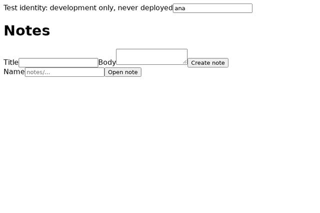

# Generic Bazel/Protobuf BFF Template

## Purpose

This is a neutral starter for contract-first web applications. A browser client and a
backend-for-frontend talk only through generated Protocol Buffer/Connect clients, and Bazel owns the
toolchains, code generation and tests. The aim is shared, versioned quality checks that run the same
way in Git hooks, in the local verifier and in CI. The local hooks and the one check registry exist, and a
separate repository consumes the checks at `quality-v1.0.0` by one pin; hosted CI has never run.

**Status: M1 to M8 are implemented and independently accepted at their revisions, locally; M8a's image is built,
tested and executed independently; hosted CI has never run, and nothing is published; the quality baseline (M9) is
open, with the Go complexity gate enforced and every other control at its measured state.** The app works:
`CreateNote` and `GetNote` run from a React page through a Go server, tested in a pinned browser. The
[specification index](specs/README.md) is the one authority on each milestone's status, the evidence
pages under [docs/evidence](docs/evidence/) list what has and has not been observed at which revision,
and [capability states](docs/quality/capability-states.md) has the summary. macOS and hosted CI are
unverified. The repository is
local-only and unpublished, and it ships no identity provider, so the production server refuses to
start until you add one ([bff/README.md](bff/README.md)). The same server is packaged as one container
image by the build graph, and that image shows the same refusal: a healthy production deployment is
unsupported until a real verifier exists ([spec 009](specs/009-bff-image/contracts/image.md)).

## How to use and test

Prerequisites: Git, bash, curl, coreutils (GNU `timeout`, `sha256sum`, `tar`) and util-linux (`flock`), on a Linux x86_64
host with glibc 2.36 or newer, which the verifier's preflight checks first. No C compiler is needed. Bazel itself, the Go SDK, Node, Python, a browser
and every check tool are fetched at pinned, checksummed versions; `tools/bootstrap/bazel.sh` verifies
the Bazel binary on every call. The verifier discards the caller's environment, so rc files, tool options and PATH helpers cannot
change a verdict. It does trust its own caches under `$HOME/.cache`: Bazel does not re-hash an
extracted install base.

```sh
tools/verify.sh --base=e3b3b348587483ed1da10957766e32615aaabb01
```

`--base` names the policy base: the commit whose evaluator judges this tree's coverage floors and
suppressions, so a change cannot approve its own weakening. Here it is the first independently reviewed
checker commit. Naming a commit proves nothing about its review, so name one you trust. Without `--base` the
verifier still runs every other check, then exits 11 and says so. A commit cannot be its own base. See
[hooks](docs/quality/hooks.md) for the setting a push uses, and [evidence](docs/quality/evidence.md) for what a
passing run does and does not claim.

The command fails closed if the host cannot provide namespace sandboxing, for example on
Ubuntu 24.04 with the default AppArmor policy. The preflight prints the fixes. If you can't apply
them, opt in to reduced isolation explicitly; the result is labeled `isolation: weakened`:

```sh
tools/verify.sh --weak-isolation --base=e3b3b348587483ed1da10957766e32615aaabb01
```

To bring the whole stack up locally and demo it (the real page, the real server, the generated client), then
open the URL it prints:

```sh
tools/bootstrap/bazel.sh run //tools/dev
```

On a host that needs reduced isolation, add `--config=weak-isolation` after `run`. The command uses the
development server, which accepts any test identity and listens only on loopback; `tools/dev/profile.json` is
the one place its ports, store and seed are declared, notes persist in a local directory until
`-- --reset`, and a busy port or an invalid value is refused by name before anything starts. See
[docs/local-demo.md](docs/local-demo.md) for the profile, persistence, restart, reset and the limitations.



*Local demo, recorded from the running stack by `tools/dev/record.sh` at the revision named in
[docs/media/local-demo.json](docs/media/local-demo.json). It shows the development identity on loopback; nothing
hosted is claimed.*

Other entry points:

| Command | What it does |
| --- | --- |
| `tools/bootstrap/bazel.sh build //bff/cmd/bff:image` | The production server as an OCI layout, built only here; `:image_tarball` loads it into a runtime elsewhere |
| `tools/bootstrap/fresh_clone.sh` | Fresh-clone witness; `--hostile` also plants rc files and a real defect |
| `tools/bootstrap/bazel.sh run //tools/hooks:install` | Installs the pinned Git hooks; see [hooks](docs/quality/hooks.md) |
| `tools/bench/measure.sh` | Feedback-cost measurement of bootstrap, first verify, warm and edited runs, or of the hook stages with `--stages-only`; results go to `docs/budgets/` |

`bazel` on your PATH is not used by the verifier. To run Bazel yourself with the same pin and rc
isolation, use `tools/bootstrap/bazel.sh`.

## What to read first

1. [Design for review](specs/001-bff-template-foundation/design.md)
2. [Constitution](.specify/memory/constitution.md)
3. [Spec of specs and milestone map](specs/001-bff-template-foundation/spec.md)
4. [Research, including the reference inspection](specs/001-bff-template-foundation/research.md)
5. [Tasks](specs/001-bff-template-foundation/tasks.md),
   [acceptance matrix](specs/001-bff-template-foundation/acceptance-matrix.md) and
   [issue map](specs/001-bff-template-foundation/issue-map.md)
6. [Provenance](docs/provenance.md) and [public-release review](docs/public-release-review.md)

## Spec Kit

Spec Kit is pinned to `github/spec-kit` v1.2.3 (commit `5ea8b1cf`) and run through a pinned uv with hash-locked dependencies. To check
that the vendored scaffold matches that release:

```sh
tools/speckit/bootstrap.sh verify
```

## Owner

Proposed: Sélamy Labs, pending the operator's approval of the public identity, recorded in the external
release packet. No public repository exists yet; public development of this reviewed core is authorized after
the existing publication checks, and one exact candidate is frozen for it. See research R-14.
