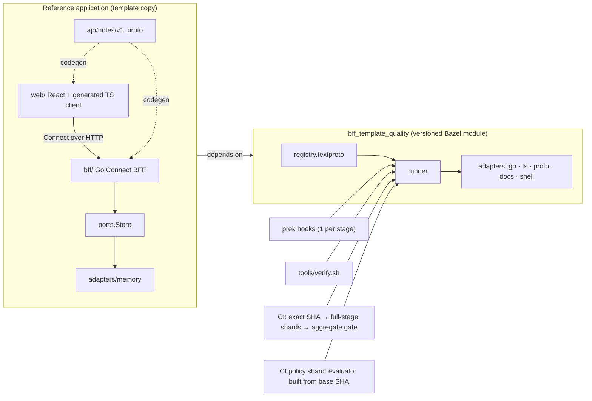

# Design for Review: Generic Bazel/Protobuf BFF Template

Status: draft for review, 2026-10-28. Decisions trace to [research.md](research.md) (R-nn).

## 1. What this is

A public starter with three separable parts:

## 2. Key decisions

| # | Decision | Why | Alternative rejected |
| --- | --- | --- | --- |
| D1 | Go BFF and TypeScript/React browser, with Connect and Bazel | Matches the reference's implemented toolchain and its planned direction (R-02, R-05) | TS BFF: removes the polyglot contract boundary |
| D2 | Neutral "notes" API with 2 RPCs, each with a browser caller | Exercises success, validation, not-found and unavailable without product semantics (R-06) | Echo/Greeter: has no realistic failure modes |
| D3 | No backend service in the slice; a storage port instead | A service with no consumer is vacuous (constitution I) | A fake domain service like the reference's method-less gRPC stubs |
| D4 | Shared checks as a versioned Bazel module plus a prek revision; app as a template copy; no generator | Smallest route with an update story (R-07) | Copy-only (no updates); generator (cost) |
| D5 | One declarative registry and one runner; one prek hook per stage; one Bazel invocation per stage; pre-commit reads staged blobs, pre-push checks the pushed commit in a detached worktree | One definition per rule; Bazel's output-base lock; prek stashes only unstaged (not untracked) changes and checks only the working tree (R-08) | Imperative shell dispatcher; per-tool prek hooks; Bazel builds over the working tree in hooks |
| D6 | Only bans and base-built floors locally; #26 policy-diff, #27 evidence validator and #28 analyzer adopted on release | No duplicate of active issue work (issue-map.md); evaluator built from base cannot be replaced by the proposal | Re-implementing the shared contracts here |
| D7 | Git, bash, curl and coreutils on the host, with Bazel itself fetched by verified pin; network off in the sandbox; pinned browsers | Constitution III; SC-001 | Host Node/Go installs |
| D8 | Deployment is an optional GCP profile with operator gates, design only until M10. Images come only from Bazel and rules_oci | RFC #30: keep the provider optional (R-13) | Deploy in the core path |

## 3. Boundaries and dependency rules (deterministic, T038)

- `web/app → web/client → generated TS`. `web/` never imports BFF code.
- `bff/transport → bff/app → bff/ports ← bff/adapters/*`. `bff/app` has no Connect or HTTP
  imports.
- `bff/testing` (test identity, fault injection) is `testonly`. `bff/cmd/bff` cannot depend on it.
- `api/` depends on nothing in the application. Generated targets depend only on `api/`.
- The application depends on `bff_template_quality`; the reverse never happens.

## 4. BFF request path

1. CORS uses exact origins only. Credentials are not allowed by default.
2. The `Authenticator` produces a Principal from the `Authorization` header only. Cookies are never
   used, so CORS allows no credentials and the BFF has no CSRF surface; cookie sessions require
   added CSRF protection (documented).
3. The Principal In dev mode it accepts `test-identity`; in production
   mode the BFF refuses `test-identity` at startup and fails closed without a verifier.
4. Deadline = min(client timeout, RPC maximum), with a 2 s default. The context is passed to the
   store.
5. protovalidate checks the request and returns `invalid_argument` with field violations.
6. The use case runs. Errors map to a fixed code table. `internal` carries only a correlation id.

## 5. Quality flow

| Stage | Trigger | Scope | Proves |
| --- | --- | --- | --- |
| pre-commit | `git commit` | staged blobs | cheap hygiene (fast feedback only) |
| pre-push | `git push` | changed packages and affected tests | changed-code checks (fast feedback only) |
| full | `tools/verify.sh` (prek `manual`), CI shards | everything | the canonical policy |
| CI aggregate | PR or main | exact SHA, all jobs | the single required verdict and receipts |

Only `full` in CI counts as evidence. Local stages are bypassable by design (`--no-verify`), and CI
does not trust them.

## 6. Guarantees vs review signals

**Guarantees** (fail the build):

- pins and locks
- secrets, suppression bans and typos
- format, lint and types
- schema breaking changes vs an immutable SHA
- generated-code freshness
- dependency rules
- tests and browser e2e
- coverage floors that only rise
- CI aggregate completeness

**Signals** (reported for human review):

- contract consumers and unused surface
- complexity and duplication, at first
- broader policy weakening, until #26 is adopted
- API-style rule choices
- budgets vs targets

**Not provable here, and never claimed:**

- SOLID, DRY or YAGNI compliance
- live branch-protection enforcement
- live billing or identity
- deployment health without runtime readback

## 7. Update and upgrade story

`bff_template_quality` releases are immutable tag commits. Each release carries notes with a rule-diff
table generated from the rule catalog and each rule's definition files; weakening entries are marked.

A consumer upgrades by changing `git_override`'s commit in `MODULE.bazel`, running the pin target's sync,
which writes prek's revision, and running `tools/verify.sh`. The diff to review is that pin change plus any
consumer edits the new rules require.

The interface is declared stable (1.0.0) only after a second neutral consumer has completed one
upgrade (M7). Template-copied app code is not updated automatically. The README says so.

## 8. Budgets

Budgets are measured before they are declared (R-11). The provisional targets below are
hypotheses on Linux x86_64 with 8 vCPU / 32 GB:

| Scenario | Provisional target |
| --- | --- |
| warm pre-commit, p95 | ≤ 5 s |
| warm pre-push, p95 | ≤ 90 s |
| warm full verify | ≤ 10 min |
| cold bootstrap | ≤ 20 min |

## 9. Optional profiles (not in the first slice)

- **GCP** (`deploy/gcp/`):
  - OpenTofu bootstrap: state bucket, migrating from local to remote state.
  - Runtime: Artifact Registry, Cloud Run, least-privilege service accounts.
  - Cloud Build: invokes the Bazel image target and publishes its digest. It does not rebuild the
    image. The deploy trigger has `approvalRequired`.
  - CI runs offline `tofu test` only. Every apply, approval and IAM change is an operator gate.
  - No identifiers are committed.
- **Worker conformance** (#29): a document showing how the runner's bounds satisfy the profile. It
  is not a runtime.

## 10. Repository and release

The proposed repository (owner decision) is `selamy-labs/bazel-protobuf-bff-template`: a public,
MIT-licensed GitHub template repository. Its settings are declared in `governance/github/`
(OpenTofu GitHub provider) and applied by an operator.

Until then the repository stays local with no origin. Publication requires
[public-release-review.md](../../docs/public-release-review.md).

## 11. Risks

| Risk | Mitigation |
| --- | --- |
| BFF and browser are new; the reference has none implemented | spike tasks T020 and T030; MVP review after Phase 4 |
| connect-go v2 is young | T020 spike, with v1.21.x as the documented fallback |
| Pinned Playwright browsers under a network-off sandbox | T030; the test fails rather than skipping |
| A proposal can delete the CI policy shard itself | stated limit; closing it needs a platform required check (owner configuration) |
| prek checks only the first pushed ref | documented; CI checks every ref |
| Pre-push worktree adds disk/warm-cache cost | measured in T059 |
| Hook latency driven by Bazel startup | one invocation per stage; measured budgets |
| Template-copy drift of app code | documented; checks are shared, apps are meant to diverge |
